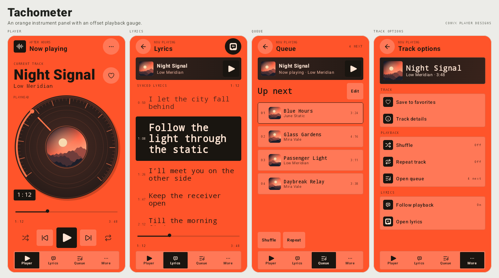
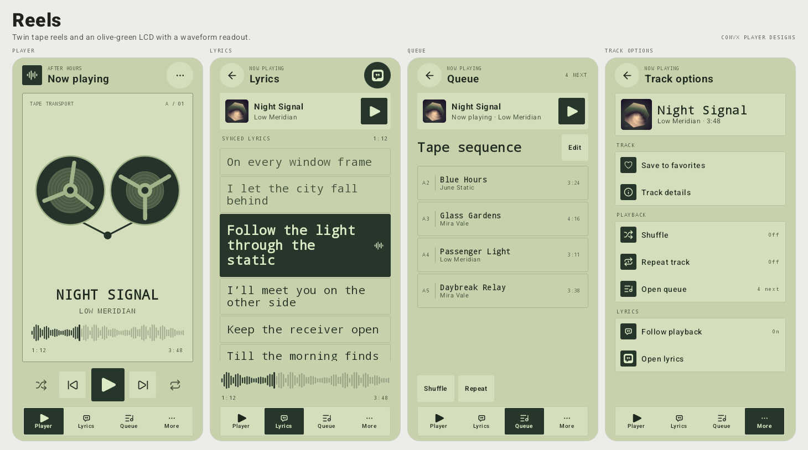
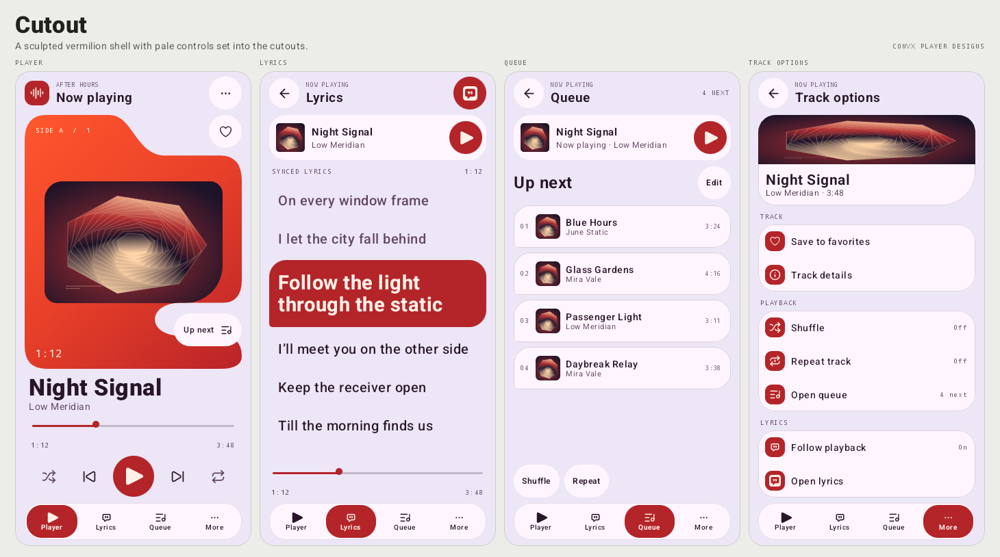
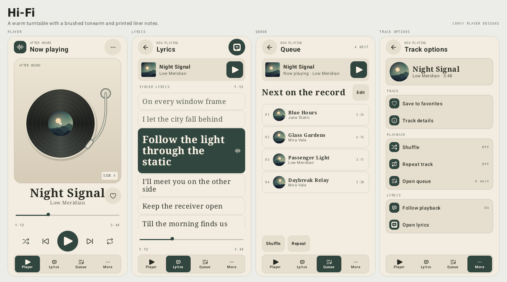
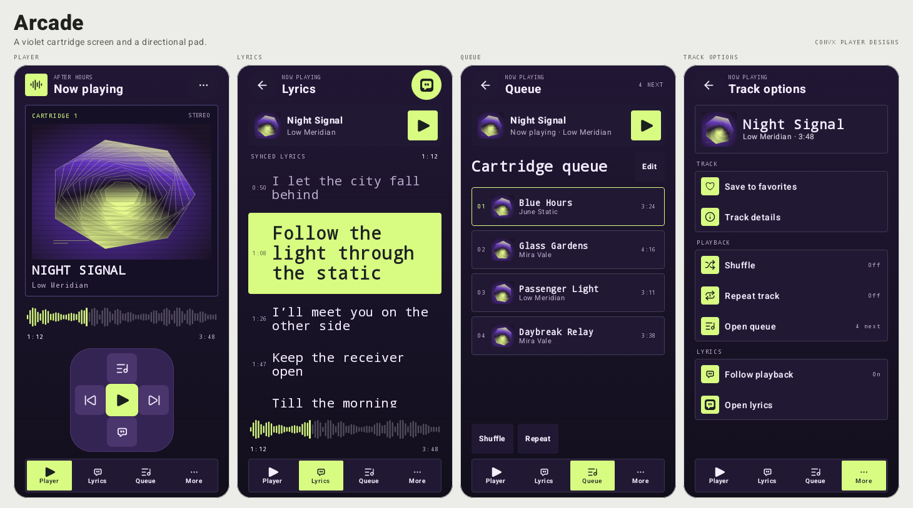
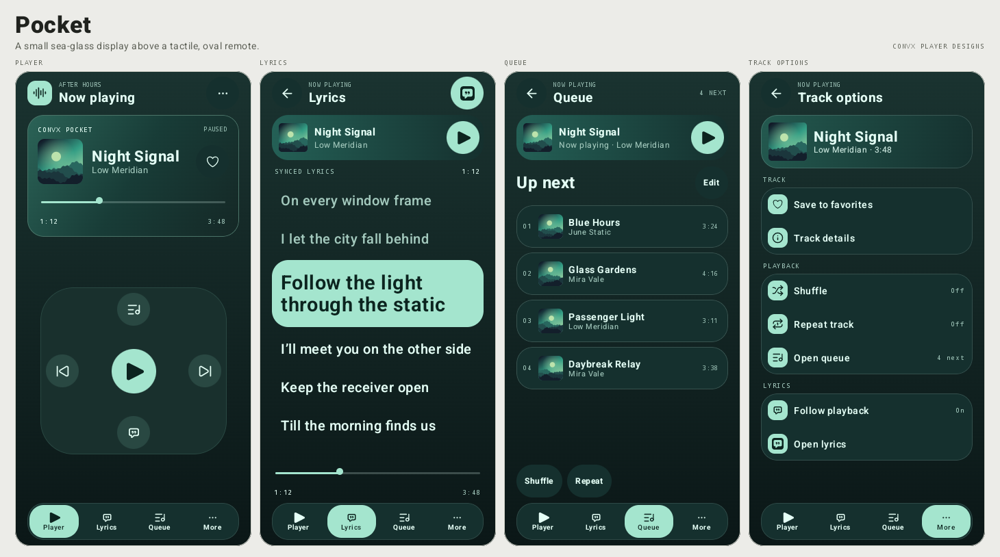
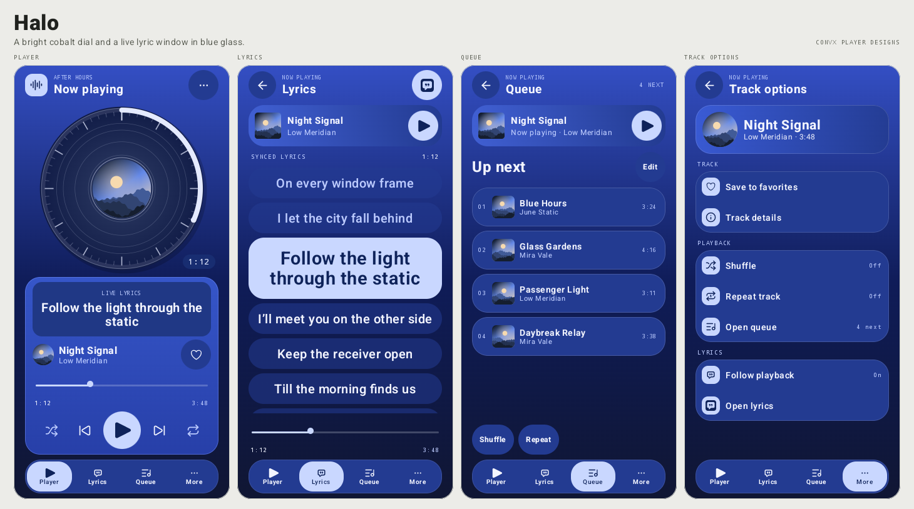
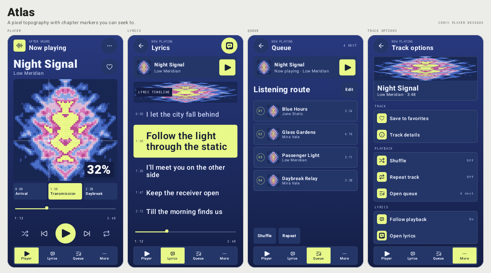

# Convx player designs

Each board shows Now Playing, Lyrics, Queue, and Track Options.

In Android Studio, open [PlayerDesignPreviews.kt](../../../app/src/debug/kotlin/com/convx/music/ui/player/studies/PlayerDesignPreviews.kt) and select **Interactive gallery** in the Preview pane. The gallery uses silent demo playback. Tap a lyric to seek, reorder the queue, or switch designs without resetting the selected track.

## Tachometer

An orange instrument panel with an offset playback gauge.

## Reels

Twin tape reels and an olive LCD with a waveform readout.

## Cutout

A vermilion shell with pale controls set into the cutouts.

## Hi-Fi

An ivory turntable with a brushed tonearm and liner-note typography.

## Arcade

A violet cartridge display with a directional pad.

## Pocket

A compact sea-glass display above an oval remote.

## Halo

A cobalt progress dial with a live lyric window.

## Atlas

Pixel terrain with tappable chapter markers.

